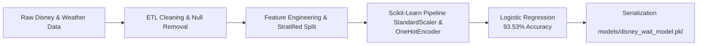

## 🎢 Predictive MLOps Pipeline: Disneyland Wait-Time Bottlenecks

Transitioning from exploratory data analysis (EDA) and ETL, this phase introduces a **production-ready, reproducible machine learning pipeline** designed to predict "High Wait" theme park bottlenecks (**>60 minutes**) across **339,064 cleaned records** combining historical wait times and hourly weather data.

### 🗺️ System Architecture & Data Flow


    
### 🛠️ Engineering & Architectural Highlights

To ensure code maintainability, prevent data leakage, and mirror real-world production standards, the pipeline incorporates:
* **Scikit-Learn `Pipeline` & `ColumnTransformer`:** Decouples preprocessing from modeling, routing numerical features (`hour_start`, `feelsLikeF`, `rainStatus`) through a `StandardScaler` and categorical text features (`Ride`) through a robust `OneHotEncoder(handle_unknown='ignore')`.
* **Optimized Convergence:** Leveraged the `saga` solver with scaled iteration bounds to achieve clean, efficient convergence on large-scale tabular data.
* **Modular MLOps Design:** Separated responsibilities into dedicated functions (`train_model`, `save_model`) with built-in execution timing.
* **Model Serialization (`joblib`):** Automatically saves the fully fitted pipeline (preserving all scaling parameters and category mappings) to disk at `models/disney_wait_model.pkl` for instant inference.

---

### 📊 Model Performance & Metrics

The baseline **Logistic Regression** model punches well above its weight class, delivering high predictive fidelity with lightning-fast execution:

| Metric | Score | Performance Context |
| :--- | :--- | :--- |
| **Accuracy Score** | **93.53%** | Overall correct classifications on the 20% holdout test set ($67,813$ rows). |
| **ROC-AUC Score** | **0.9337** | Excellent ranking quality and class separability under dataset skew. |
| **Training Duration** | **0.85 seconds** | Blazing-fast training speed across $271,251$ training samples. |

---

### 🔍 Confusion Matrix Evaluation

The model strikes a strong balance between catching critical crowd spikes and minimizing false alarms on the test set:


* **True Negatives (60,187):** Accurately identifies normal, manageable queue times.
* **True Positives (3,238):** Successfully flags severe bottlenecks exceeding the 60-minute threshold.
* **False Positives / Negatives:** Maintained low error margins relative to the massive volume of evaluation data, proving the feature engineering strategy effectively captures crowd dynamics.

---

### 🚀 Quick Start: Running Inference

Because the preprocessing rules are bundled directly into the saved pipeline object, making real-time predictions on custom scenarios requires zero manual data transformation:

```python
import joblib
import pandas as pd

# 1. Load the production pipeline from disk
model = joblib.load("models/disney_wait_model.pkl")

# 2. Define a hypothetical scenario (e.g., Radiator Springs Racers at 3 PM, 75°F)
sample_input = pd.DataFrame([{
    "hour_start": 15,
    "feelsLikeF": 75.0,
    "rainStatus": 0,
    "Ride": "Radiator Springs Racers"
}])

# 3. Predict instantly
prediction = model.predict(sample_input)
probability = model.predict_proba(sample_input)[:, 1]

status = "High Wait (>60m)" if prediction[0] == 1 else "Normal Wait (<=60m)"
print(f"Prediction: {status} ({probability[0] * 100:.2f}% bottleneck probability)")