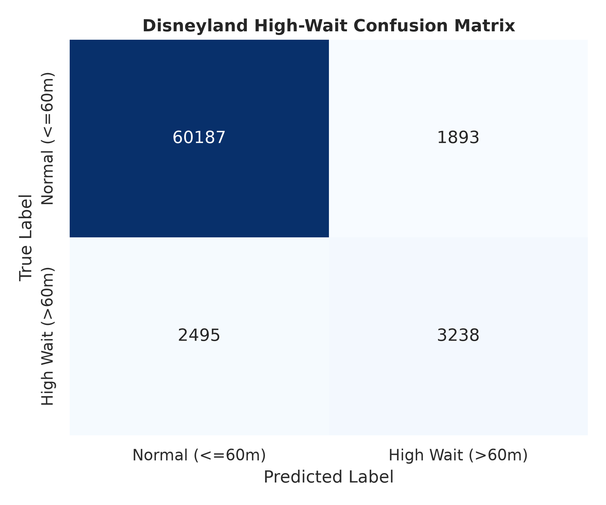
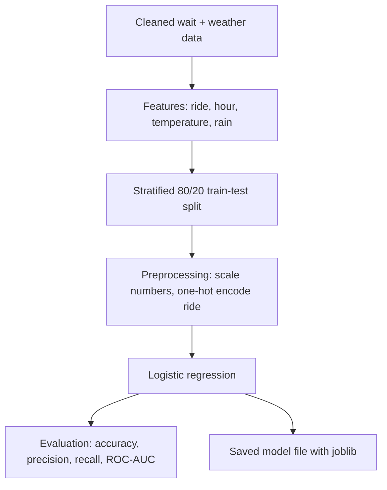

# 🎢 Predicting Long Waits at Disney California Adventure

A scikit-learn model that predicts whether a ride's wait will exceed 60 minutes, given the ride, the hour of day, the temperature, and whether it is raining. It is trained on 339,064 hourly wait records from July 2024 to June 2025.

This is Part 2 of the project. [Part 1](README.md) covers the data cleaning and analysis that produced the dataset.

## 🗺️ Summary

- **What it does:** labels each ride-hour as a severe wait (over 60 minutes) or a normal wait.
- **How well it works:** 93.5% accuracy on held-out data. That is a modest lift over always guessing "normal wait", which already scores 91.6%, because only 8.5% of ride-hours are severe. The model catches 56% of severe waits, and 63% of its warnings are correct.
- **Main finding:** the ride itself explains almost everything. A model that sees only the ride name scores 92.9%, so hour and weather add little. This matches the weather finding in Part 1.

## 📊 Results

| Metric | Score | What it means |
| :--- | :--- | :--- |
| Accuracy | 93.53% | Share of ride-hours classified correctly. Always guessing "normal" scores 91.55%. |
| ROC-AUC | 0.9337 | How well the model ranks risky ride-hours above safe ones (1.0 is perfect, 0.5 is random). |
| Precision | 63% | When the model warns of a long wait, it is right 63% of the time. |
| Recall | 56% | It catches 56% of the real 60+ minute waits (3,238 of 5,733). |
| Ride name only | 92.9% accuracy, 0.930 ROC-AUC | A baseline with no hour or weather. It performs almost as well as the full model. |

Test set: 67,813 ride-hours (20% of the data). Training set: 271,251.

### 🔍 Confusion matrix



- **60,187 normal waits** were correctly identified as normal.
- **3,238 severe waits** were correctly flagged.
- **2,495 severe waits were missed** and **1,893 normal waits were flagged by mistake**, for 4,388 wrong predictions in total (6.5%).

### 🛠️Robustness check

The data is a time series, so a random split could be too optimistic. I also held out the last 20% of dates (April 7 to June 11, 2025) and trained on everything earlier. Results held up: 93.4% accuracy and 0.950 ROC-AUC.

## 🚀 How it works



- **Target:** wait over 60 minutes (1) or not (0).
- **Preprocessing:** a scikit-learn `ColumnTransformer` scales the numeric features (hour, feels-like temperature, rain) with `StandardScaler` and one-hot encodes the ride with `OneHotEncoder(handle_unknown="ignore")`.
- **Split:** stratified, so the train and test sets keep the same 8.5% share of severe waits.
- **Model:** logistic regression with the `saga` solver, which converges well on large tabular data.
- **Saved model:** the whole fitted pipeline, including scaling and category mappings, is saved to `models/disney_wait_model.pkl`, so predictions need no manual preprocessing.

## Run it

```bash
pip install pandas scikit-learn matplotlib seaborn joblib
python main.py
```

### 🥼 Make a prediction

```python
import joblib
import pandas as pd

model = joblib.load("models/disney_wait_model.pkl")

# Radiator Springs Racers at 3 PM, feels like 75°F, no rain
sample = pd.DataFrame([{
    "hour_start": 15,  # hour of day, 0-23
    "feelsLikeF": 75.0,
    "rainStatus": 0,
    "Ride": "Radiator Springs Racers",
}])

probability = model.predict_proba(sample)[:, 1][0]
print(f"Chance of a 60+ minute wait: {probability:.0%}")
```

## 🚧 Limitations and next steps

- One park and one year of data, so results do not cover other seasons or years.
- Severe waits are rare (8.5%), so recall is the harder number to improve. Lowering the decision threshold would catch more long waits in exchange for more false alarms.
- The model leans on the ride name. Adding weekday, month, and holiday features, or trying a tree-based model such as gradient boosting, could capture more.

## ✏️ Skills demonstrated

Binary classification, logistic regression, scikit-learn Pipelines and ColumnTransformer, feature scaling, one-hot encoding, stratified train-test splitting, model evaluation (accuracy, precision, recall, ROC-AUC, confusion matrix), time-based validation, model serialization (joblib), pandas, Python.
