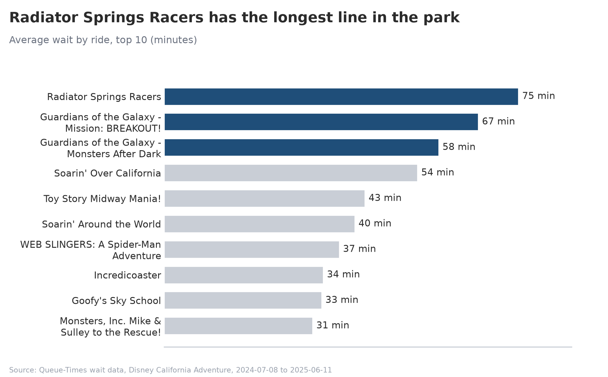
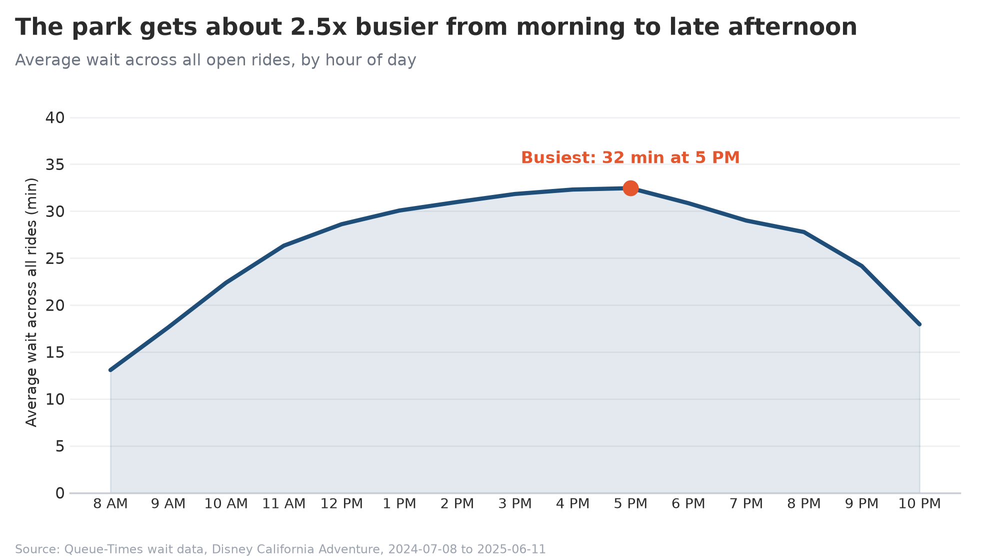
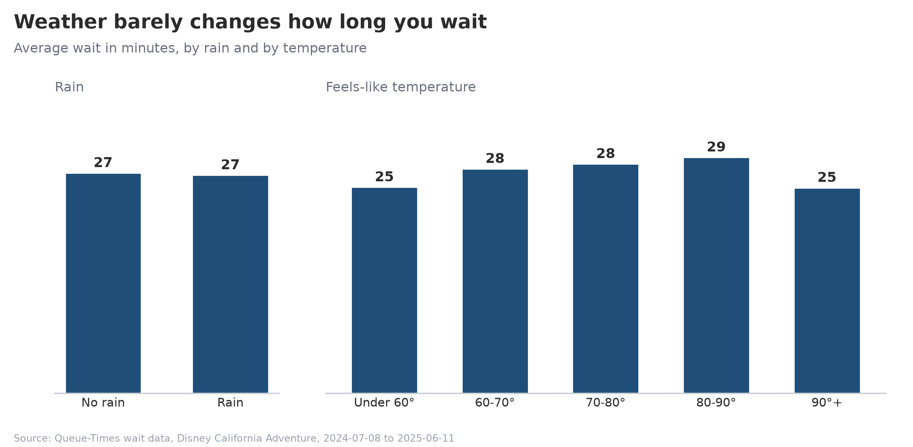

[Watch the demo](https://youtu.be/rYbNS5aMNdU)
# Disney California Adventure: Wait-Time Analysis

How crowded is Disney California Adventure, when, and does the weather matter?
This project cleans 11 months of ride wait-time data, merges it with Anaheim weather, and answers three questions with simple charts. Wait times serve as the crowd measure, because the park doesn't publish attendance.

**Data window:** July 8, 2024 to June 11, 2025 | **Park:** Disney California Adventure | **Tools:** Python, pandas, Matplotlib, Seaborn

## Questions and findings

### 1. Which rides have the longest lines?



Radiator Springs Racers has the longest average wait (75 min), followed by Guardians of the Galaxy - Mission: BREAKOUT! (67 min) and Guardians of the Galaxy - Monsters After Dark (58 min).

### 2. When is the park busiest?



The average wait across all open rides climbs from about 13 minutes at 8 AM to a peak of about 32 minutes at 5 PM (roughly 2.5x busier), then drops through the evening.

### 3. Does weather change wait times?



Barely. Average waits were 27 minutes with and without rain. Waits rise gently with temperature (25 min under 60°F, up to 29 min at 80-90°F) and dip again above 90°F, though the 90°F+ group is small.

## How it works

1. **Load:** read the wait-time and weather CSVs with pandas.
2. **Clean:**
   - Convert timestamps to datetime objects (keeping local clock time).
   - Drop rows with a wait of 0. About 48% of rows are 0, meaning the ride was closed or had no recorded wait, and they would drag the averages down.
   - Add an hourly timestamp for merging.
3. **Merge:** join each wait to the weather for the same hour.
4. **Sanity checks:** assert the merge didn't change the row count, every wait has weather, and no zero waits remain.
5. **Visualize:** three charts, each answering one question.

Result: 653,200 raw rows become 339,064 cleaned rows across 42 tracked attractions.

## Data sources

- **Wait times:** the Kaggle dataset *Disney California Adventure Wait Times* by tivory27, scraped from Queue-Times.com every 15 minutes.
- **Weather:** hourly "feels like" temperature and precipitation for Anaheim from the [Open-Meteo](https://open-meteo.com/) historical archive, downloaded with:

```
https://archive-api.open-meteo.com/v1/archive?latitude=33.81&longitude=-117.92&start_date=2024-07-01&end_date=2025-06-12&hourly=apparent_temperature,precipitation&temperature_unit=fahrenheit&timezone=America/Los_Angeles&format=csv
```

The raw CSVs are not committed because of their size. Download them into a `dataset/` folder before running.

## Run it

```bash
pip install pandas matplotlib seaborn
python main.py
```

Charts are written to `charts/`, with the data date range in each filename.

## Project structure

```
main.py        load, clean, merge, sanity checks
visuals.py     the three charts
dataset/       input CSVs (not committed)
charts/        generated images
```

## Limitations

- Wait times are the posted times, not the actual time spent in line.
- One park and about 11 months, so results cover a single year of seasons and holidays.
- Weather comes from a single Anaheim location, and rain is simplified to rain or no rain (any hour with precipitation above 0 mm).
- Collection began on the evening of July 8, 2024, so the first day is partial.

## Next steps

- Predict a ride's wait from the hour, weekday, and weather with a simple scikit-learn model.
- Compare against the 2017-18 Disneyland and California Adventure data to see how waits have changed since before the pandemic.
